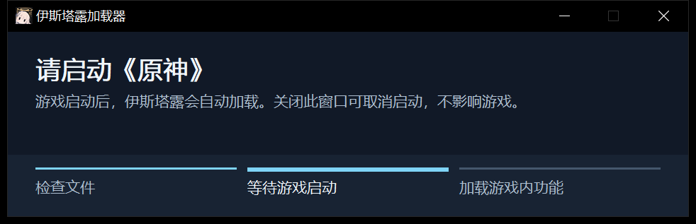

# Istaroth · 伊斯塔露

伊斯塔露是给 64 位 Windows 版《原神》用的剧情对话工具。比如，一段对话有十句话，你可以让它在每句话说完后自动翻到下一句，也可以把对话调快到 4 倍。离开工具能识别的剧情对话后，游戏会恢复原速。

**下载 v0.4.1**　[Windows 压缩包（ZIP）](https://github.com/Purfeather/Istaroth/releases/download/v0.4.1/Istaroth-v0.4.1-win64.zip) · [本版更新](docs/RELEASE-v0.4.1.md)

伊斯塔露由独立开发者维护，与米哈游（miHoYo／HoYoverse）及其关联公司没有隶属、合作、授权或背书关系。工具会把组件加载到游戏里，使用它可能导致游戏异常或账号受限，包括封禁。[使用风险声明](docs/DISCLAIMER.md)

## 第一次怎么用？

1. **解压。** 先退出原神。把下载的 ZIP 完整解压到一个新文件夹，例如桌面的“伊斯塔露”。把解压出的七个文件放在一起。**请勿放进原神安装目录或它的子文件夹。**
2. **先开伊斯塔露，再开原神。** 双击解压后的 `Istaroth.exe`，在 Windows 的管理员权限提示中选择“是”。看到“请启动《原神》”后，像平时一样启动游戏。加载成功时，小窗口会自动关闭，工具也会记住游戏的位置。
3. **进游戏后启用。** 按 **Insert** 打开菜单，点“启用”，再按一次 **Insert** 关闭菜单。菜单打开时功能会暂停，关闭后恢复原来的鼠标状态。默认倍率是 **4 倍**，可以在菜单里改。

**下次使用**时，直接双击 `Istaroth.exe`，它会从记住的位置启动游戏。每次进入游戏都默认暂停，需要在菜单里启用。**想停下来时按 F10**，工具会停止推进并请求恢复原速。更新版本前，请先完全退出游戏和加载器。[完整使用说明](docs/USAGE.txt)

## 菜单里的开关有什么用？

| 设置 | 打开后会怎样 |
| --- | --- |
| 剧情推进倍率 | 可选 1、2、3 或 4 倍。想以原速看剧情、只省去点击，就选 1 倍并打开“自动推进对话”。 |
| 自动推进对话 | 一句话结束后自动进入下一句，也能继续部分黑屏文字旁白。 |
| 自动选择首项 | 出现选项时自动选第一项。想自己决定怎么回答，就关掉这个开关。 |
| 跳过对话冷却 | 缩短文字出现后、可以点到下一句之前的等待。 |

三个开关可以分别设置。游戏上方的小面板会显示当前状态。

## 为什么有的剧情还要自己点？

莎莎的练习笔记和同段剧情后续的黑屏旁白已实测可以自动继续。遇到停在“点击后继续”的其他旁白，可以手动点一下。隐藏对话界面的常规剧情过场也已实测生效。第一句台词出现前，角色走进画面这类片段可能仍是原速；部分自带“跳过”按钮的动画也不支持加速。[幕布旁白验收范围](docs/CURTAIN-CANDIDATE.md)

工具只支持已适配的 `YuanShen.exe` 版本。游戏更新后，如果加载器提示版本不匹配，需要等工具更新。独占全屏下的菜单显示仍待实机验证。[支持的游戏版本](profiles/compatibility.json) · [故障排查](docs/TROUBLESHOOTING.md)

## 出错时怎么反馈？

记下弹窗内容、出错时间和当时的操作。双击报告工具，选择**放着 `Istaroth.exe` 的文件夹**，点“导出报告”。报告会保存在桌面的 `Istaroth-reports` 文件夹，由你决定是否发送。发送前请遮住报告或截图中的个人路径、UID 和账号信息。[下载报告工具](https://github.com/Purfeather/Istaroth/releases/download/v0.2.0/Istaroth-ReportTool-v0.1.0-win64.exe) · [诊断说明](docs/DIAGNOSTICS.md)

## 源码与许可

想自己编译或参与开发，可以从构建说明开始。`main` 保存已验收的源码，`develop` 用于开发中的改动。[构建说明](docs/BUILD.md) · [开发流程](docs/DEVELOPMENT.md) · [更新记录](CHANGELOG.md) · [历史版本](https://github.com/Purfeather/Istaroth/releases)

原创代码采用 Apache-2.0 许可证。Copyright 2026 Istaroth contributors。第三方代码遵循各自的许可，游戏名称、商标、角色和素材的权利归各自权利人所有。[许可证](LICENSE) · [代码来源](docs/PROVENANCE.md) · [素材权利说明](assets/RIGHTS.md)
